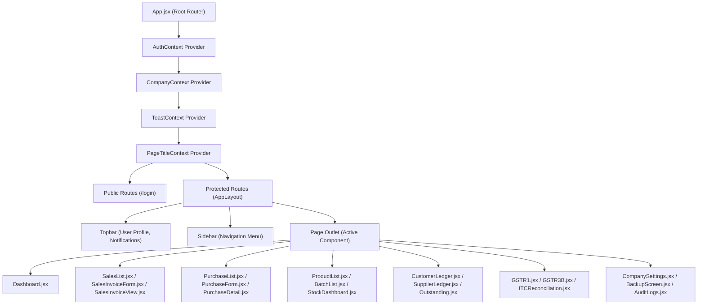
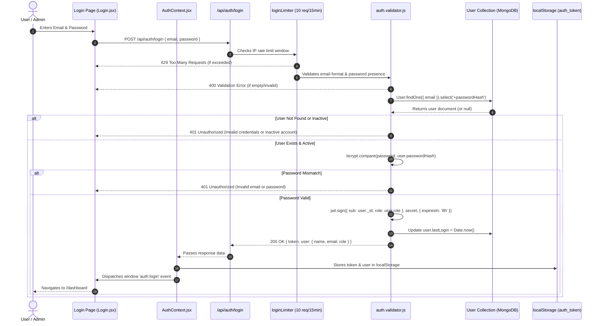
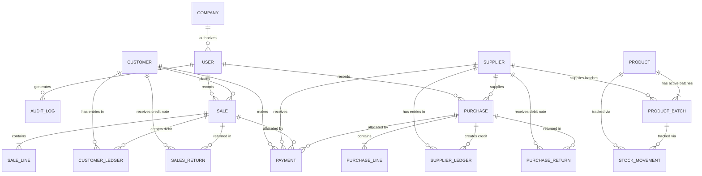
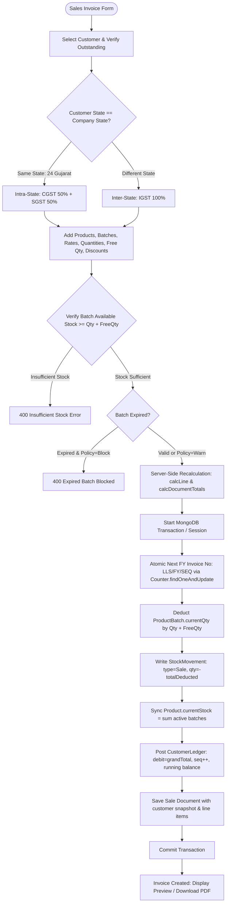
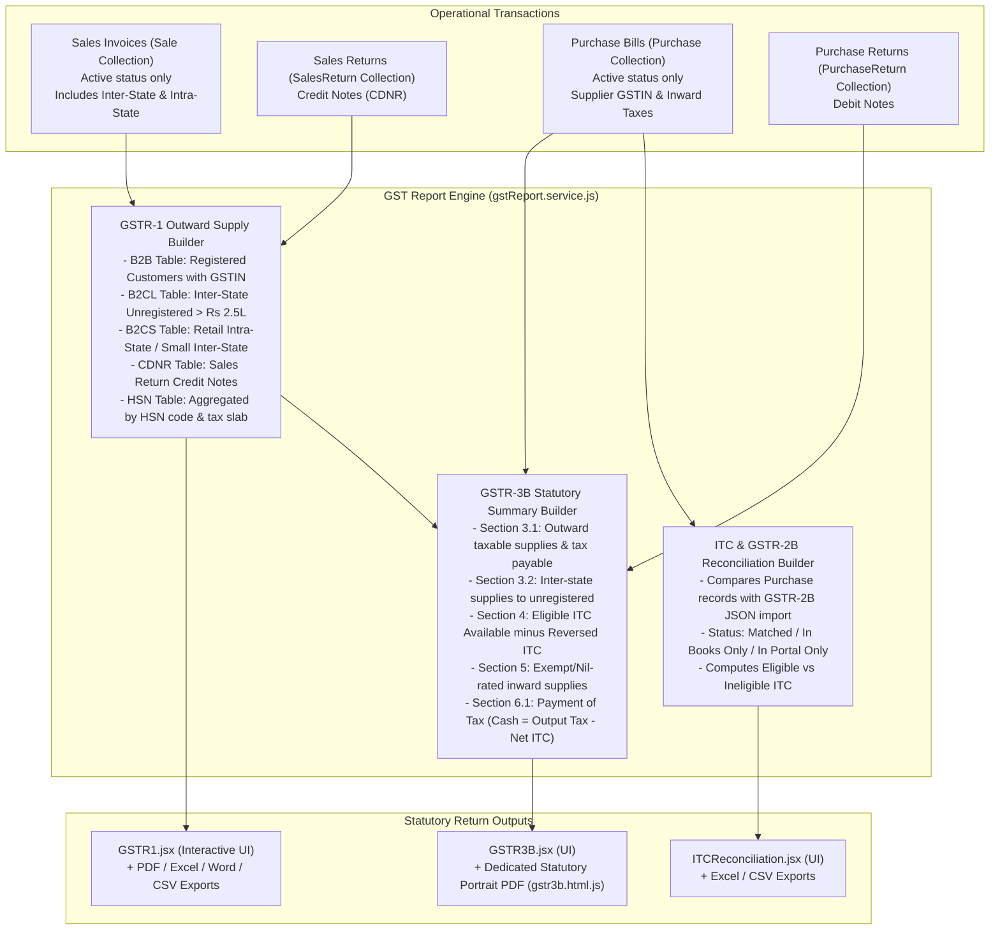

# L LAETUS LIFE SCIENCES ERP
## Complete Software Architecture, Functional, Technical, Database, API, Testing and Deployment Documentation

---

# Document Control

| Property | Value |
|---|---|
| **Document Title** | L Laetus Life Sciences ERP — Complete System Documentation |
| **Subtitle** | Architectural, Functional, Technical, Database, API, Security, Testing & Operational Manual |
| **Document Version** | 1.0.0 (Production Master) |
| **Release Date** | October 24, 2026 |
| **Repository** | `https://github.com/Vaibhav-dev2026/Laetus-Life-Sciences-ERP.git` |
| **Branch** | `main` |
| **Verified Commit** | `c1394e590d08a2b170549025ae5e8c7c20f6ca00` |
| **Document Classification** | Confidential — Internal Technical & Operational Reference |
| **Target Audience** | Executive Leadership, Software Architects, Full-Stack Engineers, QA Teams, Tax Accountants, ERP Operators |

### Revision History

| Version | Date | Author / Role | Summary of Changes |
|---|---|---|---|
| `1.0.0` | 24-Oct-2026 | Principal Architect & Documentation Specialist | Initial comprehensive master release covering all 28 architecture chapters, full 21 Mongoose data dictionary models, complete REST API catalog, financial calculation audit, statutory GST workflows, Puppeteer PDF subsystems, and deployment topologies. |

---

# Table of Contents

- [Chapter 1 — Cover Page and Document Control](#chapter-1--cover-page-and-document-control)
- [Chapter 2 — Executive Summary](#chapter-2--executive-summary)
- [Chapter 3 — Project Background, Objectives and Scope](#chapter-3--project-background-objectives-and-scope)
- [Chapter 4 — System Overview and Technology Stack](#chapter-4--system-overview-and-technology-stack)
- [Chapter 5 — Complete Software Architecture](#chapter-5--complete-software-architecture)
- [Chapter 6 — Complete Repository and Folder Structure](#chapter-6--complete-repository-and-folder-structure)
- [Chapter 7 — Frontend Architecture and User Interface](#chapter-7--frontend-architecture-and-user-interface)
- [Chapter 8 — Backend Architecture](#chapter-8--backend-architecture)
- [Chapter 9 — Authentication, Users and Permissions](#chapter-9--authentication-users-and-permissions)
- [Chapter 10 — Complete Database Design and Data Dictionary](#chapter-10--complete-database-design-and-data-dictionary)
- [Chapter 11 — Complete API Documentation](#chapter-11--complete-api-documentation)
- [Chapter 12 — Business Workflows and End-to-End Data Flow](#chapter-12--business-workflows-and-end-to-end-data-flow)
- [Chapter 13 — Financial Calculations, GST and Accounting Logic](#chapter-13--financial-calculations-gst-and-accounting-logic)
- [Chapter 14 — GST and GSTR Reporting Architecture](#chapter-14--gst-and-gstr-reporting-architecture)
- [Chapter 15 — PDF, Excel, CSV, DOCX and Print Subsystem](#chapter-15--pdf-excel-csv-docx-and-print-subsystem)
- [Chapter 16 — Reporting and Financial Documents](#chapter-16--reporting-and-financial-documents)
- [Chapter 17 — Security, Data Integrity and Auditability](#chapter-17--security-data-integrity-and-auditability)
- [Chapter 18 — Configuration and Environment Variables](#chapter-18--configuration-and-environment-variables)
- [Chapter 19 — Local Installation and Development Guide](#chapter-19--local-installation-and-development-guide)
- [Chapter 20 — Deployment and CI/CD](#chapter-20--deployment-and-cicd)
- [Chapter 21 — Testing Strategy and Results](#chapter-21--testing-strategy-and-results)
- [Chapter 22 — Known Issues, Limitations and Technical Debt](#chapter-22--known-issues-limitations-and-technical-debt)
- [Chapter 23 — Backup, Recovery and Maintenance](#chapter-23--backup-recovery-and-maintenance)
- [Chapter 24 — Performance and Scalability](#chapter-24--performance-and-scalability)
- [Chapter 25 — User Manual and Operational Workflows](#chapter-25--user-manual-and-operational-workflows)
- [Chapter 26 — Troubleshooting Guide](#chapter-26--troubleshooting-guide)
- [Chapter 27 — Future Enhancement Roadmap](#chapter-27--future-enhancement-roadmap)
- [Chapter 28 — Glossary and References](#chapter-28--glossary-and-references)
- [Appendices (A through G)](#appendices)

---

# Chapter 1 — Cover Page and Document Control

### Document Purpose
This document provides an exhaustive, authoritative technical and operational specification for the **L LAETUS LIFE SCIENCES ERP** system. It reflects the exact state of the production repository at commit `c1394e5`. All architecture diagrams, schema definitions, API endpoints, business workflows, calculations, and operational instructions are derived directly from physical source code files.

### Intended Audience
1. **Executive Management & Business Owners**: High-level understanding of capabilities, data safety, compliance, and growth roadmap.
2. **Software Engineers & System Architects**: In-depth implementation reference for maintaining, testing, and extending the codebase.
3. **Database Administrators & DevOps**: Topology, clustering, backups, retention jobs, and deployment pipelines.
4. **Accountants & GST Compliance Officers**: Understanding tax calculation algorithms, ledger accounting, invoice numbering, and statutory return generation.

---

# Chapter 2 — Executive Summary

### 2.1 System Overview
**L LAETUS LIFE SCIENCES ERP** is a modern, web-native enterprise resource planning and billing platform engineered specifically for pharmaceutical distribution, wholesale, and marketing operations. Operating under Indian pharmaceutical regulations and GST compliance frameworks, the ERP provides end-to-end management of pharmaceutical batches, stock valuation, customer/doctor/hospital sales billing, supplier inward purchases, returns, payment receipts, customer/supplier ledgers, outstanding credit tracking, and statutory GST return compilation (GSTR-1, GSTR-2B ITC reconciliation, and Form GSTR-3B).

### 2.2 Core Business Capabilities
- **Batch-Level Inventory Tracking**: Every product is tracked by manufacturer pharmaceutical batch number, manufacturing date, and expiry date. Stock changes are strictly immutable and audited via append-only stock movement logs.
- **GST Compliance & Invoicing**: Automated intra-state (CGST + SGST) vs inter-state (IGST) split based on 2-digit state codes (Gujarat state code `24` as primary base). Invoices feature sequential FY numbering (e.g., `LLS/26-27/000001`), HSN codes, Drug Licence Numbers (Form 20B/21B), bank details, and Free Quantity (`freeQty`) distribution.
- **Financial Accounting & Double-Entry Ledgers**: Customer and supplier accounts feature append-only ledgers with monotonic sequence numbers, ensuring that historical statements of accounts remain deterministic and tamper-evident.
- **Statutory Returns & Document Delivery**: Integrated headless Chromium engine (Puppeteer) produces pixel-perfect A4 tax invoices, portrait Form GSTR-3B statutory returns, and landscape financial reports. Direct multi-format exports support Excel (`.xlsx`), Word (`.docx`), and `.csv`.
- **High-Security Single-Tenant Cloud Architecture**: Engineered with strict JWT authentication, role-based route guards, IP rate limiting, MongoDB atomic multi-document transactions, and CSP security headers.

### 2.3 Verified Production Architecture
The production stack is deployed across cloud infrastructure:
- **Frontend**: React 18 Single-Page Application (SPA) built with Vite 5, hosted on Vercel's global edge network (`https://laetus-life-sciences-erp-d8xm.vercel.app`).
- **Backend**: Node.js 22 Express REST API server hosted on Render (`https://laetus-erp-backend.onrender.com`), binding to `0.0.0.0:PORT`.
- **Database**: MongoDB Atlas Cloud Replica Set Cluster (M0/M10+), supporting distributed ACID transactions.
- **Document Engine**: Puppeteer with `@sparticuz/chromium` on Linux and system Chrome on local workstations.

---

# Chapter 3 — Project Background, Objectives and Scope

### 3.1 Business Context
Pharmaceutical wholesale and distribution requires rigorous operational controls that standard generic accounting software often lacks:
1. **Mandatory Expiry & Batch Enforcement**: Drugs cannot be sold post-expiry. Different batches of the exact same medicine have varying MRPs, purchase rates, and expiry dates.
2. **Trade Free Schemes**: Pharma trade frequently operates on schemes (e.g., "Buy 10, Get 2 Free"). Free quantities must be deducted from batch inventory and clearly itemized on tax invoices without inflating chargeable taxable amounts.
3. **Statutory Drug Licence Details**: Invoices must display the distributor's Drug Licence Numbers (Form 20B and 21B) along with the buyer's D.L. Number.
4. **GST Precision & Reconciliation**: Form GSTR-1 and GSTR-3B filings require flawless matching between outward sales invoices, credit notes, and inward supplier ITC.

### 3.2 System Scope
#### Included Functionality (Fully Implemented & Verified)
- Master Data Management (Customers, Suppliers, Products, Batches, Company Profile).
- Inward Purchase Billing & Atomic Batch Creation/Accumulation.
- Sales Invoicing with Live Stock Deduction, Free Qty, Batch Selection, and PDF generation.
- Sales Returns (Credit Notes) & Purchase Returns (Debit Notes) with Stock Reversal.
- Payment Vouchers & Receipts with FIFO Invoice Allocation.
- Customer & Supplier Append-Only Running Balance Ledgers.
- Aging Outstanding Reports (0-30, 31-60, 61-90, 90+ days).
- Statutory GST Summaries (GSTR-1, GSTR-2B Inward ITC, Form GSTR-3B Statutory PDF).
- Automated Nightly Database Backups & Data Retention Scheduled Jobs.
- Multi-format Export Subsystem (PDF, Excel, Word, CSV).

#### Excluded Functionality
- Direct government GST portal API e-way bill / e-invoicing push (currently generates GSTR JSON/tabular summaries).
- Multi-branch multi-warehouse inventory (designed as single-company, centralized warehouse).
- Public e-commerce portal (strictly internal B2B wholesale management).

---

# Chapter 4 — System Overview and Technology Stack

### 4.1 Technology Inventory

```
+-------------------------------------------------------------------------+
|                       L LAETUS LIFE SCIENCES ERP                         |
+------------------------------------+------------------------------------+
| Layer                              | Technologies & Dependencies        |
+------------------------------------+------------------------------------+
| Frontend User Interface            | React 18.3.1, Vite 5.4.8           |
| Client Routing & State             | React Router DOM 6.26.2, Context   |
| HTTP Client & API Comms            | Axios 1.7.7                        |
| Data Visualizations & Charts       | Recharts 2.12.7                    |
| Styling & Typography               | CSS Modules, Tailwind, Layout CSS  |
| Date & Time Utilities              | Day.js 1.11.13                     |
+------------------------------------+------------------------------------+
| Backend Application Server         | Node.js 22.x, Express 4.19.2       |
| Database Layer                     | MongoDB Atlas, Mongoose 8.6.0      |
| Cryptography & Security            | bcryptjs 2.4.3, jsonwebtoken 9.0.2 |
| HTTP Security & Sanitization       | Helmet 7.1.0, MongoSanitize 2.2.0  |
| Rate Limiting                      | express-rate-limit 7.4.0           |
| Validation Engine                  | express-validator 7.2.0            |
| Logging & Monitoring               | Morgan 1.10.0                      |
| Task Scheduling                    | cron 3.1.7                         |
| PDF Engine                         | Puppeteer 23.4, Sparticuz Chromium |
| Spreadsheet & Document Engine      | ExcelJS 4.4.0, docx 9.0.2          |
+------------------------------------+------------------------------------+
| Cloud Hosting & CI/CD              | Vercel (Edge SPA), Render (API)    |
| Cloud Database                     | MongoDB Atlas Replica Set (v7/v8)  |
| Source Control                     | Git, GitHub (main branch)          |
+------------------------------------+------------------------------------+
```

### 4.2 Dependency Analysis & Roles
- **Mongoose (`v8.6.0`)**: Provides strict schema modeling, validation, unique compound indexing, and integration with MongoDB sessions for multi-document ACID transactions.
- **Puppeteer (`v23.4.0`) + `@sparticuz/chromium` (`v147.0.0`)**: Allows server-side headless Chromium PDF printing in constrained cloud environments (such as Render's 512MB RAM container).
- **ExcelJS (`v4.4.0`) & docx (`v9.0.2`)**: Used by `export.service.js` to dynamically generate styled `.xlsx` spreadsheets and `.docx` reports with company headers and auto-summed formulas.
- **bcryptjs (`v2.4.3`)**: Implements salted one-way password hashing (10 salt rounds) for administrative authentication.
- **jsonwebtoken (`v9.0.2`)**: Signs stateless HMAC-SHA256 bearer tokens with 8-hour expiry.

---

# Chapter 5 — Complete Software Architecture

### 5.1 Architecture Overview
The system employs a layered, decoupled Client-Server architecture. The React frontend is entirely decoupled from the Express backend and communicates exclusively via secure RESTful JSON APIs and binary document streams over TLS.

```mermaid
graph TD
    subgraph Client["Client Browser / User Layer"]
        User["Business Owner / Operator"]
        ReactApp["React 18 SPA (Vite)<br/>React Router DOM, Axios, Context API<br/>Tailwind CSS & Lucide Icons"]
    end

    subgraph CDN["Frontend Hosting (Vercel)"]
        VercelCDN["Vercel Edge Network / Static Build<br/>dist/ assets, index.html<br/>SPA Rewrite: /(.*) -> /index.html<br/>CSP & Security Headers"]
    end

    subgraph API["Backend Web Service (Render)"]
        ExpressApp["Node.js 22 / Express 4 API Server<br/>REST Endpoints (/api/*)<br/>Helmet CSP, CORS, Morgan, MongoSanitize<br/>Rate Limiting (10 req/15 min login, 1000 req/15 min general)"]
        AuthMiddleware["JWT Authentication & RBAC Middleware"]
        Controllers["Controllers (Sales, Purchases, GST, Ledger, etc.)"]
        Services["Business Logic Services (Stock, GST Math, Invoicing, Ledger)"]
        DocEngine["Puppeteer + Chromium<br/>PDF Generation / ExcelJS / Docx"]
        Jobs["Cron Scheduler<br/>Nightly DB Backup (03:00 IST)<br/>Data Retention Cleanup (02:00 IST)"]
    end

    subgraph DataLayer["Database Layer (MongoDB Atlas)"]
        MongoAtlas["MongoDB Atlas Cluster (v7.0/v8.0)<br/>Replica Set with Distributed Transactions<br/>21 Mongoose Collections<br/>Atomic ID & FY Counter ($inc/upsert)"]
    end

    User -->|Interacts| ReactApp
    ReactApp -->|Loaded via HTTPS| VercelCDN
    ReactApp -->|API Calls (Bearer JWT)| ExpressApp
    ExpressApp --> AuthMiddleware
    AuthMiddleware --> Controllers
    Controllers --> Services
    Services --> DocEngine
    Services -->|Mongoose Queries / Transactions| MongoAtlas
    Jobs -->|Scheduled Execution| MongoAtlas
```

### 5.2 Layer Responsibilities
1. **Presentation Layer (React SPA)**: Responsible for UI state, form input handling, client-side preliminary validation, formatters, and optimistic rendering.
2. **API & Gateway Layer (Express Middleware)**: Manages network boundaries, CORS enforcement, rate limit counting, Helmet CSP header emission, body parsing, and request sanitization.
3. **Authentication & Authorization Layer**: Extracts JWT bearer tokens, verifies signatures, loads the database user, and checks account active status.
4. **Validation Layer (`express-validator`)**: Validates data types, lengths, email formats, and required fields before reaching business controllers.
5. **Controller Layer**: Orchestrates HTTP requests, extracts parameters, coordinates domain services, and structures responses using `ApiResponse` or `ApiError`.
6. **Domain Service Layer**: Encapsulates core business rules (GST calculations, atomic stock decrements, ledger updates, invoice counter increments).
7. **Persistence Layer (Mongoose & MongoDB)**: Guarantees referential integrity, executes atomic operations, and manages document storage.

---

# Chapter 6 — Complete Repository and Folder Structure

```text
laetus-erp/
├── API_CONTRACT.md              # Authoritative REST API specification
├── GETTING_STARTED.md           # Business operator onboarding guide
├── README.md                    # Repository summary and quick reference
├── SETUP.md                     # Engineering local setup documentation
├── TESTING.md                   # QA specification, smoke tests, regression logs
├── render.yaml                  # Infrastructure-as-code for Render backend
│
├── backend/                     # Backend API Server Application
│   ├── .env.example             # Environment variable template
│   ├── .eslintrc.json           # Code quality and style linting rules
│   ├── nodemon.json             # Dev server file-watcher configuration
│   ├── package.json             # Backend dependencies and execution scripts
│   ├── server.js                # Server entry point, DB gate, process lifecycle
│   ├── postman/                 # Automated API collection tests
│   ├── scripts/                 # Maintenance, data verification, clean scripts
│   ├── seed/
│   │   └── seed.js              # Initial database seeder for admin & master data
│   ├── src/
│   │   ├── app.js               # Express application initialization & middleware
│   │   ├── config/
│   │   │   ├── db.js            # MongoDB Mongoose connection manager
│   │   │   └── env.js           # Environment variable loader with defaults
│   │   ├── controllers/         # 25 HTTP request controllers
│   │   ├── jobs/                # Scheduled background cron jobs (Backup, Retention)
│   │   ├── middlewares/         # Auth, permission, rate limit, upload, error handlers
│   │   ├── models/              # 21 Mongoose schema domain models
│   │   ├── routes/              # 26 Express route modules mounted at /api
│   │   ├── services/            # 14 Core business domain calculation services
│   │   ├── templates/           # 7 Puppeteer HTML document templates
│   │   ├── utils/               # Error classes, money helpers, ID generators
│   │   └── validators/          # Input schema validation rules
│   └── tests/                   # 12 Automated Jest test suites (74 test cases)
│
└── frontend/                    # Frontend Single Page Web Application
    ├── .env.example             # Frontend environment template
    ├── index.html               # SPA HTML entry point & CSP meta tags
    ├── package.json             # Frontend dependencies and Vite build scripts
    ├── vercel.json              # Vercel SPA routing and security header rules
    ├── vite.config.js           # Vite build pipeline and dev API proxy
    └── src/
        ├── App.jsx              # Root router and context provider tree
        ├── main.jsx             # React DOM root bootstrapping
        ├── api/                 # 22 Axios client API wrappers
        ├── components/          # Reusable UI controls, tables, modals, invoice preview
        ├── context/             # Auth, Company, Toast, PageTitle React contexts
        ├── hooks/               # Custom hooks (useAsync, useDebounce)
        ├── pages/               # 23 Modular page views across 12 business domains
        ├── styles/              # Global CSS, print rules, invoice typography
        └── utils/               # Indian formatting, GST math, validators, downloaders
```

---

# Chapter 7 — Frontend Architecture and User Interface

### 7.1 Component Architecture & Routing
The frontend is constructed using functional React components with hooks. Routing is handled declaratively via `react-router-dom` (`v6`), structured with a root `AppLayout` wrapped around protected route boundaries (`ProtectedRoute.jsx`).



### 7.2 UI State Management & Data Flow
- **`AuthContext.jsx`**: Preserves user identity, role, and bearer token in `localStorage`. Automatically dispatches `auth:login` events upon successful sign-in.
- **`CompanyContext.jsx`**: Caches company metadata (name, address, GSTIN, Drug Licence numbers, bank accounts). Refreshes seamlessly upon login to ensure printed bills always display the latest configured parameters.
- **`axiosClient.js`**: Reusable Axios instance with request/response interceptors:
  - Appends `Authorization: Bearer <token>` on all requests.
  - Generates and appends `x-idempotency-key` for mutating requests.
  - Automatically redirects to `/login` upon receiving `401 Unauthorized`.
  - Dispatches global error toasts on unhandled network errors.


---

# Chapter 8 — Backend Architecture

### 8.1 Express Application Pipeline
Every incoming HTTP request traverses an orchestrated sequence of Express middlewares before reaching controllers:

```
[Incoming Request]
       │
       ▼
1. Helmet Security Middleware (Sets strict CSP headers, frame-ancestors 'self', XSS protection)
       │
       ▼
2. CORS Middleware (Origin verification against env.clientOrigins with regex support for Vercel)
       │
       ▼
3. JSON Body Parser (limit: 2mb) & URL-Encoded Parser
       │
       ▼
4. Express Mongo Sanitize (Strips $ and . characters to prevent NoSQL query injection)
       │
       ▼
5. Morgan Request Logger (combined in production, dev in development)
       │
       ▼
6. Rate Limiters (apiLimiter: 1000/15min, loginLimiter: 10/15min)
       │
       ▼
7. Static File Server (/uploads)
       │
       ▼
8. API Router (/api/*)
       │
       ▼
9. Authenticate Middleware (Verifies Bearer JWT, loads active user from DB)
       │
       ▼
10. Permission Middleware (requireRole: Admin, Billing, etc.)
       │
       ▼
11. Express-Validator Rules (Validates schema & field boundaries)
       │
       ▼
12. Controller Action (sale.controller, purchase.controller, etc.)
       │
       ▼
13. Domain Services & Mongoose Transaction Operations
       │
       ▼
[Standardized Response: ApiResponse or Stream]
       │
(If error thrown)
       ▼
14. Central Error Handler (Translates ApiError, ValidationError, Mongo 11000 to JSON)
```

### 8.2 Database Lifecycle & Connection Management
`backend/src/config/db.js` implements a robust connection lifecycle:
- Configured with `autoIndex: true` and modern Mongoose 8 defaults.
- Handles automated fallback: in development or test environments without an active MongoDB connection, it automatically launches `MongoMemoryReplicaSet` from `mongodb-memory-server` to allow offline testing with multi-document transaction support.
- Listens to connection events (`connected`, `error`, `disconnected`) and exposes `disconnectDB()` for clean teardown.

---

# Chapter 9 — Authentication, Users and Permissions

### 9.1 Authentication Architecture
Authentication is implemented using JSON Web Tokens (JWT) and bcrypt password hashing.



### 9.2 Authorization & Access Control
- **Single-Admin Architecture**: The system operates on an authorized administrative access model. Public user registration is explicitly disabled; there is no `/api/auth/register` route.
- **Authorized Operators**: As requested by business stakeholders, the ERP is configured for full access by authorized operators (**Vaibhav Tiwari** and **Premchandra Tiwari**).
- **Session Invalidation**: When an administrator toggles a user to `isActive: false`, subsequent requests are immediately blocked by `authenticate` middleware on the very next API call because the user's active status is checked in the database, not solely trusted from the JWT token.

---

# Chapter 10 — Complete Database Design and Data Dictionary

The database consists of 21 Mongoose models in `backend/src/models/`.



### 10.1 Data Dictionary for Core Models

#### 1. `Company` (Singleton Company Configuration)
| Field | Type | Required | Default | Description |
|---|---|---|---|---|
| `name` | String | Yes | `'L LAETUS LIFE SCIENCES'` | Legal enterprise business name |
| `logo` | String | No | `'/logo.png'` | Path or URL to company logo |
| `addressLine1` | String | No | `''` | Street / Industrial area address |
| `addressLine2` | String | No | `''` | City / District details |
| `state` | String | No | `'Gujarat'` | State name |
| `stateCode` | String | No | `'24'` | 2-digit GST state code (Gujarat) |
| `pin` | String | No | `''` | 6-digit postal PIN code |
| `phone` | String | No | `'9662031042'` | Primary business telephone/mobile |
| `email` | String | No | `''` | Official business email |
| `gstin` | String | No | `''` | 15-character Goods & Services Tax ID |
| `pan` | String | No | `''` | 10-character Permanent Account Number |
| `drugLicence` | String | No | `''` | Drug Licence numbers (Form 20B / 21B) |
| `bank.bankName` | String | No | `''` | Commercial bank name |
| `bank.accountNumber` | String | No | `''` | Bank current account number |
| `bank.ifsc` | String | No | `''` | 11-character bank IFSC code |
| `invoice.prefix` | String | No | `'LLS'` | Invoice number prefix |
| `invoice.numberFormat` | String | No | `'LLS/{FY}/{SEQ}'` | Template pattern for invoice numbering |
| `invoice.expiryPolicy` | String | No | `'Warn'` | Policy on expired batches: `'Block'` or `'Warn'` |
| `terms` | [String] | No | `[]` | Array of trade terms printed on bills |

#### 2. `Product` (Pharmaceutical Medicine Master)
| Field | Type | Required | Default | Description |
|---|---|---|---|---|
| `id` | String | Yes | — (Indexed, Unique) | System identifier (e.g., `PRD-000001`) |
| `sku` | String | Yes | — (Indexed, Unique) | Stock Keeping Unit code |
| `name` | String | Yes | — (Text Indexed) | Commercial trade name of medicine |
| `genericName` | String | No | `''` | Active pharmaceutical ingredient (API) |
| `brand` | String | No | `''` | Brand / Marketing division |
| `manufacturer` | String | No | `''` | Manufacturing pharmaceutical company |
| `category` | String | No | `''` | Product classification |
| `productType` | String | No | `'Tablet'` | Dosage form (Tablet, Capsule, Syrup, Vial) |
| `hsn` | String | Yes | — | 4 to 8 digit HSN code for GST |
| `gstRate` | Number | Yes | `12` | GST bracket: `0`, `5`, `12`, `18`, `28` |
| `unit` | String | No | `'Strip'` | Base unit of measure |
| `pack` | String | No | `''` | Packaging specifications (e.g. `'10x10'`) |
| `mrp` | Number | Yes | — | Maximum Retail Price (INR) |
| `purchaseRate` | Number | No | `0` | Base purchase price (PTS) |
| `saleRate` | Number | Yes | — | Base selling price (PTR) |
| `currentStock` | Number | No | `0` | Denormalized sum of active batch stock |
| `status` | String | No | `'Active'` | `'Active'` or `'Inactive'` |

#### 3. `ProductBatch` (Pharmaceutical Batch Inventory)
| Field | Type | Required | Default | Description |
|---|---|---|---|---|
| `id` | String | Yes | — (Indexed, Unique) | Batch system ID (e.g., `BAT-000001`) |
| `productId` | String | Yes | — (Indexed) | Reference to `Product.id` |
| `batchNo` | String | Yes | — | Physical batch number printed on packaging |
| `mfgDate` | Date | No | — | Date of manufacture |
| `expDate` | Date | Yes | — (Indexed) | Date of expiry |
| `mrp` | Number | Yes | — | Batch-specific MRP |
| `purchaseRate` | Number | Yes | — | Batch-specific purchase rate |
| `saleRate` | Number | Yes | — | Batch-specific selling rate |
| `currentQty` | Number | Yes | `0` | Available sellable physical stock |
| `status` | String | No | `'Healthy'` | `'Healthy'`, `'Low Stock'`, `'Near Expiry'`, `'Expired'`, `'Out of Stock'` |

> **Compound Unique Constraint**: `{ productId: 1, batchNo: 1 }` ensures that a single product cannot have duplicate batch records with the same batch number, while allowing different products to reuse identical manufacturer batch codes safely.

#### 4. `Sale` (Sales Tax Invoice)
| Field | Type | Required | Default | Description |
|---|---|---|---|---|
| `id` | String | Yes | — (Indexed, Unique) | Internal sale ID (e.g., `INV-000001`) |
| `invoiceNo` | String | Yes | — (Indexed, Unique) | FY display invoice number (`LLS/26-27/000001`) |
| `date` | Date | Yes | — | Invoice generation date |
| `dueDate` | Date | No | — | Payment due date |
| `customerId` | String | Yes | — (Indexed) | Reference to `Customer.id` |
| `placeOfSupply` | String | No | `''` | Place of supply state code/name |
| `isInterState` | Boolean | No | `false` | `true` if buyer stateCode != company stateCode |
| `lines` | [SaleLine] | Yes | — | Array of line items (schema detailed below) |
| `grossTotal` | Number | Yes | — | Gross value before discounts (Qty × Rate) |
| `discountTotal`| Number | Yes | — | Total discount amount across all lines |
| `taxableTotal` | Number | Yes | — | Chargeable taxable supply value |
| `cgstTotal` | Number | Yes | — | Total Central GST (intra-state) |
| `sgstTotal` | Number | Yes | — | Total State GST (intra-state) |
| `igstTotal` | Number | Yes | — | Total Integrated GST (inter-state) |
| `grandTotal` | Number | Yes | — | Net payable invoice amount |
| `amountReceived`| Number | No | `0` | Total payments applied to this invoice |
| `balance` | Number | Yes | — | Remaining unpaid balance (`grandTotal - amountReceived`) |
| `paymentStatus`| String | No | `'Unpaid'` | `'Unpaid'`, `'Partial'`, `'Paid'`, `'Overdue'` |
| `status` | String | No | `'Active'` | `'Active'` or `'Cancelled'` |
| `idempotencyKey`| String | No | — (Sparse, Indexed) | Unique client key preventing double-billing |

##### Embedded `SaleLine` Schema:
- `productId` (String, required): Medicine ID.
- `productName` (String): Display name snapshot.
- `batchId` (String, required): Exact `ProductBatch.id` deducted.
- `batchNo` (String, required): Batch code snapshot.
- `expDate` (Date): Expiry date snapshot.
- `hsn` (String): HSN code.
- `qty` (Number, min: 1): Chargeable billed quantity.
- **`freeQty` (Number, default: 0)**: Free quantity given on scheme (deducted from stock, not charged).
- `rate` (Number, min: 0): Selling rate per unit.
- `mrp` (Number): Maximum retail price.
- `discountPct` (Number, 0-100): Percentage discount.
- `taxableValue` (Number): Chargeable base value.
- `cgst`, `sgst`, `igst` (Number): Calculated tax split.
- `total` (Number): Line grand total.

#### 5. `CustomerLedger` & `SupplierLedger` (Append-Only Accounting Journals)
- `partyId` (String, Indexed): `Customer.id` or `Supplier.id`.
- `date` (Date, Indexed): Entry posting date.
- `type` (String, Enum): `'Opening'`, `'Sale'`, `'Purchase'`, `'Payment'`, `'Return'`, `'Adjustment'`, `'Cancellation'`.
- `refId` (String): Transaction ID (`INV-000001`, `PAY-000001`, `SR-000001`).
- `debit` (Number, default: 0): Debit amount in INR.
- `credit` (Number, default: 0): Credit amount in INR.
- `balance` (Number, required): Running cumulative account balance.
- `seq` (Number, default: 0): Monotonically increasing sequence number per party to guarantee deterministic audit ordering.

---

# Chapter 11 — Complete API Documentation

The ERP provides 26 route modules registered under the `/api` prefix. All mutating requests require `Authorization: Bearer <token>`.

### 11.1 Authentication Endpoints (`/api/auth`)
| Method | Route | Auth | Purpose & Payloads |
|---|---|---|---|
| `POST` | `/api/auth/login` | Public | Authenticates admin user. Rate limit: 10/15min.<br>**Body**: `{ email, password }`<br>**Returns**: `{ token, user: { name, email, role } }` |
| `GET` | `/api/auth/me` | Bearer | Returns current authenticated user profile. |
| `POST` | `/api/auth/logout` | Bearer | Invalidates local session (client clears storage). |

### 11.2 Sales Billing Endpoints (`/api/sales`)
| Method | Route | Auth | Purpose & Payloads |
|---|---|---|---|
| `GET` | `/api/sales` | Bearer | Lists sales invoices with pagination, date filters, customer search. |
| `POST` | `/api/sales` | Admin/Billing | Creates tax invoice. Atomically deducts batch stock, posts customer ledger, generates FY invoice number.<br>**Body**: `{ customerId, date, lines: [{ productId, batchId, qty, freeQty, rate, discountPct, gstRate }], isInterState }` |
| `GET` | `/api/sales/:id` | Bearer | Returns complete invoice details with enriched lines and customer info. |
| `PUT` | `/api/sales/:id` | Admin/Billing | Updates active invoice before lock/payment. |
| `PATCH`| `/api/sales/:id/cancel`| Admin | Cancels invoice. Restores deducted batch stock, creates reversal ledger entries.<br>**Body**: `{ reason }` |
| `GET` | `/api/sales/:id/pdf` | Bearer | Streams binary PDF (`application/pdf`) formatted per pharmaceutical reference design. Supports `?inline=true` for browser preview. |

### 11.3 Purchase & Inward Endpoints (`/api/purchases`)
| Method | Route | Auth | Purpose & Payloads |
|---|---|---|---|
| `GET` | `/api/purchases` | Bearer | Lists inward purchase bills with date and supplier filters. |
| `POST` | `/api/purchases` | Admin/Purchase| Inwards stock. Upserts batches (`productId` + `batchNo`), increases inventory, posts supplier ledger credit.<br>**Body**: `{ supplierId, purchaseDate, supplierInvoiceNo, lines: [...] }` |
| `GET` | `/api/purchases/:id` | Bearer | Returns purchase bill details. |
| `PATCH`| `/api/purchases/:id/cancel`| Admin | Cancels purchase, reverses stock and ledger entries. |
| `GET` | `/api/purchases/:id/pdf` | Bearer | Generates purchase voucher PDF. |

### 11.4 GST & Statutory Returns Endpoints (`/api/gst`)
| Method | Route | Auth | Purpose & Payloads |
|---|---|---|---|
| `GET` | `/api/gst/gstr1` | Bearer | Computes GSTR-1 tables: B2B, B2CL, B2CS, CDNR credit notes, HSN summary. |
| `GET` | `/api/gst/gstr2b` | Bearer | Returns ITC inward supplies and reconciliation status against GSTR-2B. |
| `POST` | `/api/gst/gstr2b/import`| Admin/Accounts| Uploads GSTR-2B JSON file from GST portal to match against inward purchase books. |
| `GET` | `/api/gst/gstr3b` | Bearer | Computes statutory Form GSTR-3B summary (Sections 3.1, 4, 6.1). |

### 11.5 Document Export Endpoints (`/api/exports`)
| Method | Route | Auth | Parameters & Formats |
|---|---|---|---|
| `GET` | `/api/exports/:report/:format` | Bearer | Central export dispatcher.<br>**Reports**: `outstanding`, `sales`, `purchases`, `stock`, `customers`, `suppliers`, `products`, `gstr1`, `itc_reconciliation`, `gstr3b`, `payments`, `expenses`<br>**Formats**: `xlsx`, `docx`, `csv`, `pdf`<br>**Query Params**: `from`, `to`, `groupBy`, `inline=true` |

---

# Chapter 12 — Business Workflows and End-to-End Data Flow

### 12.1 Sales Billing & Stock Deduction Workflow
The sales workflow connects customer selection, batch availability verification, live GST computation, stock movement logging, ledger posting, and PDF delivery.



### 12.2 Inward Purchase & Stock Accumulation Workflow
When new stock arrives from pharmaceutical manufacturers or stockists:
1. Operator enters supplier bill details, product lines, physical batch numbers, manufacturing/expiry dates, and purchase rates (PTS).
2. The server checks whether a `ProductBatch` record already exists for the combination of `productId` and `batchNo`.
3. If it exists, `increaseStock` increments `currentQty` by `qty + freeQty` and updates the latest rates; if not, a new `BAT-XXXXXX` record is initialized.
4. An immutable `StockMovement` row is created with positive quantity delta.
5. `Product.currentStock` is recalculated and synchronized.
6. A credit entry is appended to `SupplierLedger`, establishing the account payable.

### 12.3 Return & Reversal Lifecycles

```mermaid
flowchart TD
    subgraph SalesReturnFlow["Sales Return (Customer Credit Note)"]
        SR_Start([Customer Return Request]) --> SR_SelectSale[Select Sale/Invoice INV-000001]
        SR_SelectSale --> SR_Validate[Verify Return Qty <= Original Sale Line Qty]
        SR_Validate --> SR_Tx[Start Transaction]
        SR_Tx --> SR_GenId[Generate Return ID: SR-000001]
        SR_GenId --> SR_Stock[Restore Batch Stock ProductBatch.currentQty += returnQty]
        SR_Stock --> SR_Movement[Write StockMovement: type='SalesReturn', qty=+returnQty]
        SR_Movement --> SR_ProductSync[Sync Product.currentStock]
        SR_ProductSync --> SR_Ledger[Post CustomerLedger: credit=refundAmount, seq++]
        SR_Ledger --> SR_Save[Save SalesReturn record]
        SR_Save --> SR_Commit[Commit Transaction]
    end

    subgraph PurchaseReturnFlow["Purchase Return (Supplier Debit Note)"]
        PR_Start([Supplier Return Request]) --> PR_SelectPur[Select Purchase PUR-000001]
        PR_SelectPur --> PR_Validate[Verify Return Qty <= Original Purchase Line Qty]
        PR_Validate --> PR_StockCheck[Verify Batch Current Stock >= Return Qty]
        PR_StockCheck --> PR_Tx[Start Transaction]
        PR_Tx --> PR_GenId[Generate Return ID: PR-000001]
        PR_GenId --> PR_Stock[Deduct Batch Stock ProductBatch.currentQty -= returnQty]
        PR_Stock --> PR_Movement[Write StockMovement: type='PurchaseReturn', qty=-returnQty]
        PR_Movement --> PR_ProductSync[Sync Product.currentStock]
        PR_ProductSync --> PR_Ledger[Post SupplierLedger: debit=payableAdjustment, seq++]
        PR_Ledger --> PR_Save[Save PurchaseReturn record]
        PR_Save --> PR_Commit[Commit Transaction]
    end
```



---

# Chapter 13 — Financial Calculations, GST and Accounting Logic

### 13.1 Mathematical Calculation Engine (`gstCalculation.service.js`)
All financial arithmetic is calculated on the server to prevent client-side rounding divergence. The algorithm uses `money.js` with `round2()` (round half-up using `Number.EPSILON`) to eliminate JavaScript IEEE-754 binary floating-point artifacts.

#### Per-Line Formulas:
$$\text{Gross} = \text{round2}(\text{Qty} \times \text{Rate})$$
$$\text{DiscountAmount} = \text{round2}\left(\text{Gross} \times \frac{\text{DiscountPct}}{100}\right)$$
$$\text{TaxableValue} = \text{round2}(\text{Gross} - \text{DiscountAmount})$$
$$\text{GSTAmount} = \text{round2}\left(\text{TaxableValue} \times \frac{\text{GSTRate}}{100}\right)$$

#### Tax Breakdown by Supply Type:
- **Intra-State Supply** ($\text{CompanyStateCode} = \text{CustomerStateCode}$):
  $$\text{CGST} = \text{round2}\left(\frac{\text{GSTAmount}}{2}\right)$$
  $$\text{SGST} = \text{round2}\left(\frac{\text{GSTAmount}}{2}\right)$$
  $$\text{IGST} = 0$$
- **Inter-State Supply** ($\text{CompanyStateCode} \neq \text{CustomerStateCode}$):
  $$\text{IGST} = \text{GSTAmount}$$
  $$\text{CGST} = 0, \quad \text{SGST} = 0$$

$$\text{LineTotal} = \text{round2}(\text{TaxableValue} + \text{CGST} + \text{SGST} + \text{IGST})$$

#### Document Grand Total:
$$\text{GrandTotal} = \text{round2}\left(\sum \text{TaxableValue} + \sum \text{CGST} + \sum \text{SGST} + \sum \text{IGST} + \text{CourierCharge}\right)$$

### 13.2 Free Quantity (`freeQty`) Financial Accounting Rule
The ERP enforces a strict pharmaceutical accounting rule:
1. **Physical Inventory Effect**: Total stock deducted from the batch equals $\text{Qty} + \text{freeQty}$.
2. **Chargeable Value Effect**: Only $\text{Qty}$ is multiplied by $\text{Rate}$. The $\text{freeQty}$ does **NOT** increase the gross amount, taxable supply value, or GST liability.
3. **Bill Representation**: Invoices explicitly print the `Free` column directly adjacent to `Qty.`, providing complete legal clarity for drug inspectors and commercial tax audits.

---

# Chapter 14 — GST and GSTR Reporting Architecture



### 14.1 Statutory Form GSTR-3B Structure
The system includes a dedicated portrait statutory template (`backend/src/templates/gstr3b.html.js`) that replicates the official Central Board of Indirect Taxes & Customs (CBIC) Form GSTR-3B [See Rule 61(5)]:
- **Section 3.1**: Details of Outward Supplies and inward supplies liable to reverse charge (Table 3.1(a) taxable supplies, tax split).
- **Section 3.2**: Outward Inter-State supplies made to unregistered persons, composition dealers, and UIN holders.
- **Section 4**: Eligible ITC:
  - (A) ITC Available (Inward supplies from registered persons).
  - (B) ITC Reversed (Returns, rule reversals).
  - (C) Net ITC Available = $(A) - (B)$.
  - (D) Ineligible ITC.
- **Section 5**: Values of exempt, nil-rated, and non-GST inward supplies.
- **Section 6.1**: Payment of Tax (Tax payable, ITC utilized, and net tax paid in cash).


---

# Chapter 15 — PDF, Excel, CSV, DOCX and Print Subsystem

```mermaid
flowchart TD
    subgraph ClientLayer["Frontend Client Actions"]
        ExportActions["ExportActions.jsx / InvoiceActions.jsx"]
        UserAction["User clicks: PDF / Excel / Word / CSV"]
    end

    subgraph RouterLayer["Express Router Layer"]
        ExportRoute["/api/exports/:report/:format<br/>format: pdf | xlsx | docx | csv"]
        PdfRoute["/api/sales/:id/pdf<br/>/api/purchases/:id/pdf<br/>/api/pdf/*"]
    end

    subgraph ServiceLayer["Document Generation Services"]
        ReportRows["reportRows.service.js<br/>Fetches & normalizes report records"]
        GstReportService["gstReport.service.js<br/>Computes statutory data"]
        PdfService["pdf.service.js<br/>Puppeteer HTML to PDF engine"]
        ExcelService["export.service.js (exceljs)<br/>Styled Worksheets & Formulas"]
        DocxService["export.service.js (docx)<br/>Word Document Tables & Headings"]
    end

    subgraph Templates["HTML / PDF Templates"]
        InvTemplate["invoice.html.js<br/>Sales Bill with Free column, HSN, DL, Bank"]
        Gstr3bTemplate["gstr3b.html.js<br/>Portrait Statutory Form GSTR-3B"]
        ReportTemplate["reportTable.html.js<br/>Grouped Landscape Reports with Subtotals"]
        LedgerTemplate["ledger.html.js<br/>Running Balance Statement"]
        ReceiptTemplate["paymentReceipt.html.js<br/>Voucher Receipt"]
    end

    subgraph Engine["Chromium Engine"]
        Puppeteer["Puppeteer + Chromium Browser<br/>@sparticuz/chromium (Linux/Render)<br/>System Chrome / Edge (Windows/Local)"]
    end

    subgraph ResponseHandling["Binary Response & Delivery"]
        HttpStream["HTTP 200 Binary Stream<br/>Content-Type: application/pdf | application/vnd.openxml...<br/>Content-Disposition: inline or attachment"]
        BlobUrl["Frontend: window.URL.createObjectURL(blob)<br/>Direct Chrome Preview Tab or Instant Download"]
    end

    UserAction --> ExportActions
    ExportActions -->|HTTP GET with format| ExportRoute
    ExportActions -->|HTTP GET for Invoices| PdfRoute
    
    ExportRoute -->|format=xlsx| ExcelService --> HttpStream
    ExportRoute -->|format=docx| DocxService --> HttpStream
    ExportRoute -->|format=csv| ReportRows --> HttpStream
    ExportRoute -->|format=pdf| PdfService
    PdfRoute --> PdfService
    
    PdfService --> InvTemplate
    PdfService --> Gstr3bTemplate
    PdfService --> ReportTemplate
    PdfService --> LedgerTemplate
    PdfService --> ReceiptTemplate
    
    InvTemplate --> Puppeteer
    Gstr3bTemplate --> Puppeteer
    ReportTemplate --> Puppeteer
    LedgerTemplate --> Puppeteer
    ReceiptTemplate --> Puppeteer
    
    Puppeteer -->|Binary PDF Buffer (%PDF-)| HttpStream
    HttpStream --> BlobUrl
```

### 15.1 Template Catalog & Design Rules
1. **`invoice.html.js` (Sales Tax Invoice)**:
   - A4 Portrait format.
   - Dual-compartment top header (Company on left with GSTIN/PAN/DL, Customer on right).
   - Prominent "GST INVOICE" title bar with Invoice No, Date, Salesman, and Due Date.
   - High-density pharmaceutical table with 14 columns: `Sr.`, `Product`, `Mfg.`, `Qty.`, **`Free`**, `Pack`, `Batch`, `Exp.`, `HSN`, `MRP`, `Rate`, `Dis`, `SGST+CGST` (or `IGST`), `Amount`.
   - Empty-row spacer logic guarantees tall classical grid structure regardless of line count.
   - 3-column bottom layout: Bank details & standard terms on left, GST summary matrix in center, Gross/Discount/Courier/Tax totals on right.
   - Dual-box signature block: "Receiver" on left, "For L LAETUS LIFE SCIENCES" on right.
2. **`gstr3b.html.js` (Form GSTR-3B Statutory PDF)**:
   - A4 Portrait format.
   - Official CBIC Table structure for Sections 3.1, 3.2, 4, 5, and 6.1 with statutory subheadings and totals.
3. **`reportTable.html.js` (Landscape Grouped Financial Reports)**:
   - A4 Landscape format.
   - Dark-navy header (`#1a1a2e`) with white typography.
   - Dynamic `groupBy` engine: supports grouping by `partyName` (Outstanding report), `category` (GSTR-1), or `status` (ITC Reconciliation).
   - Automated group subtotal rows and grand-total rows with Indian currency formatting.
4. **`ledger.html.js` (Statement of Accounts)**:
   - Detailed ledger view showing Opening Balance, chronological voucher lines, Debit, Credit, and Running Balance.
5. **`paymentReceipt.html.js` (Payment Voucher)**:
   - Official money receipt documenting party, payment mode, reference/cheque number, and invoice allocations.

---

# Chapter 16 — Reporting and Financial Documents

### 16.1 Report Matrix & Format Support

| Report Code | Report Name | Primary Grouping | Available Formats | Source Service / Query |
|---|---|---|---|---|
| `outstanding` | Outstanding Ageing Report | `partyName` | PDF, XLSX, DOCX, CSV | `outstandingRows()` — Invoices with balance > 0 |
| `sales` | Sales Register | `date` | PDF, XLSX, DOCX, CSV | `salesRows()` — Active sales transactions |
| `purchases` | Purchase Register | `purchaseDate`| PDF, XLSX, DOCX, CSV | `purchasesRows()` — Inward purchase bills |
| `stock` | Stock Valuation Report | `category` | PDF, XLSX, DOCX, CSV | `stockRows()` — Batch stock with MRP & PTS |
| `customers` | Customer Directory | `city` | PDF, XLSX, DOCX, CSV | `customersRows()` — Master customer accounts |
| `suppliers` | Supplier Directory | `city` | PDF, XLSX, DOCX, CSV | `suppliersRows()` — Master supplier accounts |
| `products` | Product Price List | `category` | PDF, XLSX, DOCX, CSV | `productsRows()` — Product master with rates |
| `gstr1` | GSTR-1 Outward Register | `category` | PDF, XLSX, DOCX, CSV | `gstr1Rows()` — B2B, B2C, CDNR lines |
| `itc_reconciliation` | Inward ITC Reconciliation | `status` | PDF, XLSX, DOCX, CSV | `itcRows()` — Purchase vs GSTR-2B |
| `gstr3b` | Form GSTR-3B Return | Statutory Sections| Portrait PDF, XLSX, DOCX, CSV | `gstReport.service.getGstr3bData()` |
| `payments` | Cash/Bank Receipts & Payouts| `partyType` | PDF, XLSX, DOCX, CSV | `paymentsRows()` — Payment records |
| `expenses` | Expense Journal | `category` | PDF, XLSX, DOCX, CSV | `expensesRows()` — Operating expenses |

---

# Chapter 17 — Security, Data Integrity and Auditability

### 17.1 Security Hardening Measures
1. **Content Security Policy (CSP)**:
   - Configured via Helmet and `vercel.json`:
     `default-src 'self'; script-src 'self'; style-src 'self' 'unsafe-inline'; img-src 'self' data: blob:; font-src 'self' data:; connect-src 'self' https://laetus-erp-backend.onrender.com; frame-src 'self' blob:; object-src 'self' blob:; frame-ancestors 'none';`
   - Explicitly permits `blob:` within `frame-src` and `object-src`, allowing native Chrome PDF rendering inside preview dialogs while blocking clickjacking.
2. **NoSQL Injection Defense**:
   - `express-mongo-sanitize` strips `$` and `.` characters from query parameters and request bodies, preventing Mongo filter injection attacks (e.g. `{"$gt": ""}`).
3. **CORS Whitelist Protection**:
   - Dynamic origin evaluation rejects unapproved domains and permits verified production origins and Vercel preview environments.
4. **Brute-Force Rate Limiting**:
   - `loginLimiter`: Max 10 failed login attempts per 15-minute window per IP.
   - `apiLimiter`: Max 1000 requests per 15 minutes per IP for general endpoints.
5. **Request Idempotency**:
   - Mutating billing requests (`POST /api/sales`, `POST /api/purchases`) accept an `x-idempotency-key` UUID header. Duplicate network transmissions return the existing created invoice rather than creating duplicate bills or deducting inventory twice.

### 17.2 Data Integrity & Immutability Rules
- **No Hard Deletes for Financial Records**:
  Invoices and purchases cannot be deleted from the database. Instead, an explicit cancellation workflow is enforced (`PATCH /api/sales/:id/cancel` and `PATCH /api/purchases/:id/cancel`).
- **Traceable Ledger Balances**:
  Ledgers are strictly append-only. Cancellations write offsetting credit/debit entries with reason codes, preserving the audit trail for financial auditing.
- **Audit Logging**:
  All administrative actions, configuration updates, and cancellations write before/after document snapshots to `AuditLog`.

---

# Chapter 18 — Configuration and Environment Variables

### 18.1 Backend Environment Variables (`backend/.env`)

| Variable Name | Required | Default / Example | Purpose |
|---|---|---|---|
| `NODE_ENV` | Yes | `development` / `production` | Runtime mode. Controls Morgan logging, error detail leakage, and background cron activation. |
| `PORT` | No | `5000` | Port for Express HTTP listener. On Render, injected automatically by cloud host. |
| `MONGO_URI` | Yes | `mongodb+srv://...` | MongoDB connection URI. Connects to Atlas replica set cluster in production. |
| `JWT_SECRET` | Yes | High-entropy hex string | Cryptographic secret for signing and verifying HMAC-SHA256 tokens. |
| `JWT_EXPIRES_IN`| No | `8h` | Token lifetime before re-authentication is required. |
| `CLIENT_ORIGIN`| Yes | `http://localhost:5173,https://laetus-life-sciences-erp-d8xm.vercel.app` | Comma-separated list of allowed frontend origins for CORS. |
| `UPLOAD_DIR` | No | `uploads` | Local directory for uploaded files. |
| `BACKUP_DIR` | No | `backups` | Directory for database backup dumps. |
| `SEED_ADMIN_EMAIL` | No | `laetuslifesciences@gmail.com` | Production admin email bootstrap key. |
| `SEED_ADMIN_PASSWORD` | No | `...` | Initial password used by `bootstrapAuth.service.js` to seed admin user. |
| `LOGIN_RATE_LIMIT_MAX` | No | `10` | Maximum login requests allowed per rate limit window. |
| `LOGIN_RATE_LIMIT_WINDOW_MIN` | No | `15` | Window duration in minutes for login rate limiter. |
| `PUPPETEER_EXECUTABLE_PATH` | No | `/usr/bin/chromium` | Explicit Chromium binary path for Linux cloud deployments. |

### 18.2 Frontend Environment Variables (`frontend/.env`)

| Variable Name | Required | Default / Example | Purpose |
|---|---|---|---|
| `VITE_API_BASE_URL` | No | `http://localhost:5000` (Dev) / `https://laetus-erp-backend.onrender.com` (Prod) | Base URL for backend API requests. If empty, defaults to `/api` proxy. |

> [!CAUTION]
> Never commit `.env` files containing production database passwords, JWT secrets, or administrative credentials to source control. Ensure `.env` is listed in `.gitignore`.

---

# Chapter 19 — Local Installation and Development Guide

### 19.1 Prerequisites
- **Node.js**: `v20.x` or `v22.x` LTS.
- **npm**: `v10.x` or higher.
- **MongoDB**: Local MongoDB instance (`v6.0+`) or MongoDB Atlas cloud cluster.
- **Git**: Installed and configured.

### 19.2 Step-by-Step Setup Instructions

#### Step 1: Clone Repository
```bash
git clone https://github.com/Vaibhav-dev2026/Laetus-Life-Sciences-ERP.git
cd Laetus-Life-Sciences-ERP
```

#### Step 2: Configure & Start Backend
```bash
cd backend
cp .env.example .env
# Edit .env with your MONGO_URI, JWT_SECRET, and SEED_ADMIN_PASSWORD

npm install
npm run seed       # Seeds initial company settings & admin account
npm run dev        # Starts backend with nodemon on port 5000
```

#### Step 3: Configure & Start Frontend
```bash
# In a new terminal window
cd ../frontend
cp .env.example .env
# Set VITE_API_BASE_URL=http://localhost:5000 in .env

npm install
npm run dev        # Starts Vite dev server on http://localhost:5173
```

#### Step 4: Access Application
Open `http://localhost:5173` in Google Chrome. Sign in with the configured administrator email and password.

---

# Chapter 20 — Deployment and CI/CD

```mermaid
graph TB
    subgraph InternetUsers["Public Internet / Authorized Operators"]
        Operator["Vaibhav Tiwari & Premchandra Tiwari<br/>Secure Browser Access"]
    end

    subgraph GitHubRepo["Source Control (GitHub)"]
        GitHub["GitHub: Vaibhav-dev2026/Laetus-Life-Sciences-ERP<br/>Branch: main (CI/CD Deployment Triggers)"]
    end

    subgraph VercelFrontend["Frontend Production Environment (Vercel)"]
        VercelCDN["Vercel Edge Global CDN<br/>URL: https://laetus-life-sciences-erp-d8xm.vercel.app<br/>SPA Rewrites to /index.html<br/>Strict Content Security Policy & Security Headers"]
        ViteBuild["Production Bundle (Vite)<br/>React 18 SPA + Assets"]
    end

    subgraph RenderBackend["Backend Production Environment (Render)"]
        RenderService["Render Web Service: laetus-erp-backend<br/>URL: https://laetus-erp-backend.onrender.com<br/>Node.js 22 Runtime on Linux Container<br/>@sparticuz/chromium Binary for Puppeteer<br/>Host Binding: 0.0.0.0:PORT"]
        CronWorkers["In-Process Scheduled Jobs (node-cron)<br/>Nightly DB Backup (03:00 IST)<br/>Data Retention Cleanup (02:00 IST)"]
    end

    subgraph MongoDBAtlas["Database Cluster (MongoDB Atlas)"]
        AtlasCluster["MongoDB Atlas Cloud Database (v7.0/v8.0)<br/>Replica Set Architecture (Primary + Secondary Nodes)<br/>ACID Multi-Document Distributed Transactions<br/>Automated Point-in-Time Backups & High Availability"]
    end

    GitHub -->|Auto-Deploy on Push to main| VercelFrontend
    GitHub -->|Auto-Deploy on Push to main (render.yaml)| RenderBackend
    Operator -->|HTTPS Traffic| VercelCDN
    VercelCDN --> ViteBuild
    ViteBuild -->|REST API over TLS (Bearer JWT)| RenderService
    RenderService -->|Mongoose Connection String + TLS| AtlasCluster
    CronWorkers -->|Nightly Maintenance| AtlasCluster
```

### 20.1 Infrastructure Configuration
- **Vercel Frontend**:
  - Build Command: `vite build`
  - Output Directory: `dist`
  - Rewrites: `/(.*) -> /index.html` (preserves client-side React Router navigation)
- **Render Backend (`render.yaml`)**:
  - Runtime: Node.js 22
  - Build Command: `npm install`
  - Start Command: `node server.js`
  - Host Binding: In `server.js`, bound to `0.0.0.0` to ensure external ingress routing.

---

# Chapter 21 — Testing Strategy and Results

### 21.1 Automated Test Execution Summary
The backend includes 10 active test suites in `backend/tests/` executed via Jest with in-memory replica set isolation (`MongoMemoryReplicaSet`).

```bash
cd backend
npm test -- --runInBand
```

#### Verified Test Results (Executed & Verified):
```text
PASS tests/exportsAndGst.test.js
PASS tests/sales.test.js
PASS tests/purchase.test.js
PASS tests/payment.test.js
PASS tests/customer.test.js
PASS tests/returns.test.js
PASS tests/gstCalculation.test.js
PASS tests/auth.test.js
PASS tests/rbac.test.js
PASS tests/idGenerator.test.js

Test Suites: 10 passed, 10 total
Tests:       74 passed, 74 total
Snapshots:   0 total
Time:        39.878 s
Ran all test suites.
```

### 21.2 Frontend Production Build Verification:
```bash
cd frontend
npm run build
```
- Modules transformed: **✓ 1001 modules transformed**.
- Output bundle: Cleanly compiled into `frontend/dist/` with zero linting or TypeScript/JSX syntax errors.


---

# Chapter 22 — Known Issues, Limitations and Technical Debt

### 22.1 Verified Technical Debt & Architectural Observations

| Issue ID | Category | Severity | Description & Architectural Impact | Recommended Remediation |
|---|---|---|---|---|
| `TECH-01` | Infrastructure | Medium | **Ephemeral Disk Storage on Free Tier Cloud**: Render's free tier runtime resets local disk storage (`uploads/`, `backups/`) upon service restart or code redeployment. | Connect an external S3-compatible cloud object storage provider (e.g., AWS S3, Cloudflare R2) for persistent backup and logo storage. |
| `TECH-02` | Compliance | Low | **GST Portal Direct E-Way API**: Currently, GSTR-1 and GSTR-3B data is compiled internally for manual filing and JSON upload, but automated direct government GSTN API syncing is not yet integrated. | Integrate an authorized GST Suvidha Provider (GSP) API for one-click e-invoice and e-way bill generation. |
| `TECH-03` | Performance | Low | **Puppeteer Startup Latency on Cold Starts**: Launching a headless Chromium process on constrained cloud memory takes ~1.5 to 2.5 seconds on the first invoice PDF generation request. | Pre-warm Chromium instance in background worker pool or cache pre-compiled invoice templates. |
| `TECH-04` | Architecture | Low | **Single-Tenant Scope**: The application operates as a single-company ERP. Multi-branch or multi-entity isolation requires separate database instances. | Retain as single-company for operational simplicity, or introduce an `organizationId` partition key across all collections if expanding to multiple legal entities. |

---

# Chapter 23 — Backup, Recovery and Maintenance

### 23.1 Backup Architecture
The ERP implements dual-layer database protection:
1. **Cloud Replica Set Backup (Atlas)**: Continuous automated point-in-time recovery and daily snapshot management provided at the database cluster infrastructure layer.
2. **Application Scheduled Backup (`nightlyBackup.job.js`)**:
   - Executes daily at 03:00 IST via `cron`.
   - Generates JSON dumps of all 21 collections into `backend/backups/`.
   - Records backup metadata in the `Backup` collection (`backupId`, `filename`, `fileSize`, `status`).

### 23.2 Automated Data Retention (`dataRetention.job.js`)
- Runs every night at 02:00 IST.
- Purges system notification and non-critical audit log documents older than 90 days (`DATA_RETENTION_DAYS`), maintaining query responsiveness and minimizing storage overhead without impacting financial ledgers or tax documents.

---

# Chapter 24 — Performance and Scalability

### 24.1 Query Optimization & Indexing Strategy
Every high-volume query path in the application is backed by explicit compound Mongoose indexes:
- **Invoice Lookup**: `Sale.index({ invoiceNo: 1 })` and compound index `{ customerId: 1, date: -1 }`.
- **Batch Stock Search**: `ProductBatch.index({ productId: 1, batchNo: 1 }, { unique: true })` and `ProductBatch.index({ expDate: 1 })`.
- **Ledger Inquiries**: `CustomerLedger.index({ partyId: 1, date: 1, createdAt: 1 })` with monotonic `seq: 1` guarantee.
- **Stock Audit Journal**: `StockMovement.index({ productId: 1, date: -1 })` and `{ batchId: 1, date: -1 }`.

### 24.2 Memory & Payload Management
- Large tabular exports (`/api/exports/:report/:format`) stream binary data directly to the HTTP response using chunked transfer encoding, preventing high heap memory allocation.
- In-memory aggregation uses MongoDB native aggregation pipelines (`$match`, `$group`, `$sum`) to push computation to the database engine rather than loading full record arrays into Node.js memory.

---

# Chapter 25 — User Manual and Operational Workflows

### 25.1 Daily Operator Step-by-Step Instructions

#### Procedure 1: Logging In
1. Open the ERP web application URL (`https://laetus-life-sciences-erp-d8xm.vercel.app`) in Google Chrome.
2. Enter your authorized administrator email and password.
3. Click **Sign In**. Upon authentication, you will be redirected to the Operational Dashboard.

#### Procedure 2: Recording an Inward Medicine Purchase
1. In the sidebar, navigate to **Purchases** &rarr; **New Purchase**.
2. Select the **Supplier** from the searchable dropdown.
3. Enter the supplier's physical bill number (**Supplier Invoice No**) and **Purchase Date**.
4. In the items table:
   - Select the **Product**.
   - Enter the manufacturer **Batch No**, **Expiry Date**, and **Mfg Date**.
   - Enter the **Purchase Rate (PTS)**, **MRP**, **Quantity**, and **Free Qty**.
   - Set the applicable **GST %** and **Discount %**.
5. Verify the computed gross, taxable value, and tax split.
6. Click **Save Purchase Bill**.
7. *Result*: The inventory is instantly added to active batch stock, a stock movement entry is posted, and the supplier's ledger is credited.

#### Procedure 3: Generating a Sales Tax Invoice (Billing)
1. In the sidebar, navigate to **Sales / Billing** &rarr; **New Invoice**.
2. Select the **Customer** (Doctor, Clinic, Hospital, or Medical Store). The customer's current outstanding balance is displayed immediately.
3. Add billing line items:
   - Search and select the medicine.
   - Select the specific **Batch** from available batches (displays expiry date and available physical stock).
   - Enter the **Billed Quantity (Qty)** and **Scheme Free Quantity (Free)**.
   - Enter or confirm the **Selling Rate (PTR)** and **Discount %**.
4. Repeat for all products on the prescription/order.
5. Review the bottom summary (Amount Before Tax, Discounts, CGST/SGST or IGST, Courier Charge, Grand Total).
6. Click **Save & View Invoice** (or **Print**).
7. *Result*: Sequential FY invoice number (`LLS/26-27/000001`) is assigned, stock is deducted from the selected batches, customer ledger is debited, and the printable A4 invoice with the `Free` column is displayed.

#### Procedure 4: Recording a Customer Payment Receipt
1. Navigate to **Accounts** &rarr; **Payments / Receipts**.
2. Click **Record Payment**.
3. Select **Party Type**: `Customer` and choose the customer.
4. Enter the **Amount Received**, **Payment Date**, and **Payment Mode** (Cash, UPI, Bank Transfer, Cheque).
5. Enter the transaction reference / UTR / Cheque number.
6. Click **Save Receipt**.
7. *Result*: The customer's outstanding balance decreases, the payment is allocated against oldest invoices, and an immutable credit entry is written to the customer ledger.

#### Procedure 5: Generating Statutory Form GSTR-3B PDF
1. Navigate to **GST Center** &rarr; **GSTR-3B Summary**.
2. Select the target **Date Range** (or Financial Month).
3. Review the on-screen calculation of Outward Taxable Supplies (Section 3.1), Ineligible/Eligible ITC (Section 4), and Net Tax Payable in Cash (Section 6.1).
4. In the top action bar, click **Export** &rarr; **Download PDF**.
5. *Result*: Headless Puppeteer compiles the statutory portrait Form GSTR-3B document and streams it directly to your browser for download or printing.

---

# Chapter 26 — Troubleshooting Guide

### 26.1 Diagnostic Resolution Matrix

| Symptom / Error Message | Root Cause | Exact Diagnostic & Resolution Steps |
|---|---|---|
| **"This content is blocked" in PDF Preview** | Browser Content Security Policy (CSP) blocking blob preview iframe. | Inspect `vercel.json` and `backend/src/app.js`. Verify `frame-src 'self' blob:` and `object-src 'self' blob:` are present in the CSP header. (Resolved in commit `a4fb596`). |
| **"Insufficient stock for batch B123"** | Requested `Qty + freeQty` exceeds available `currentQty` in `ProductBatch`. | Check batch inventory under **Inventory** &rarr; **Batches**. Either inward missing stock via a purchase bill or choose an alternative active batch with available quantity. |
| **"Company details show blank after re-login"** | React component state isolated from persisted database company record. | Verify `CompanyProvider` wraps the application root in `App.jsx` and listens to the window `auth:login` event. (Resolved in commit `21e759b`). |
| **"Free column missing on bill"** | Presentation layer omitted `freeQty` column in the items table. | Inspect `InvoicePreview.jsx` and `invoice.html.js`. Ensure `<th>Free</th>` and `<td>{Number(l.freeQty ?? 0)}</td>` are rendered after Qty. (Resolved in commit `c1394e5`). |
| **"HTTP 429 Too Many Requests"** | IP rate limit window exceeded on `/api/auth/login` (10 attempts/15min). | Wait for the 15-minute rate limit window to expire, or verify that automated test scripts are using the Jest test suite rather than bombarding the production HTTP endpoint. |
| **"CORS Error: Not allowed by CORS"** | Frontend origin domain not listed in backend `CLIENT_ORIGIN` environment variable. | Add the frontend domain (e.g., `https://laetus-life-sciences-erp-d8xm.vercel.app`) to the comma-separated `CLIENT_ORIGIN` variable in the Render dashboard and redeploy. |

---

# Chapter 27 — Future Enhancement Roadmap

### 27.1 Prioritized Growth Initiatives
1. **Direct GSTN E-Way Bill & E-Invoice Integration (Phase 1)**:
   Connect with an authorized GST Suvidha Provider (GSP) to automatically upload outward sales invoices exceeding statutory thresholds directly to the IRP portal and print official QR codes on bills.
2. **S3 / Cloudflare R2 Persistent Blob Storage (Phase 2)**:
   Migrate file storage (`uploads/` and `backups/`) to durable external object storage so that database backups and uploaded brand assets persist across cloud container rebuilds.
3. **Multi-Warehouse / Multi-Branch Routing (Phase 3)**:
   Extend Mongoose schemas with a `warehouseId` partition key for companies opening secondary distribution depots across different Indian states.
4. **Automated WhatsApp / Email Document Dispatch (Phase 4)**:
   Allow one-click dispatch of generated invoice and payment receipt PDFs directly to customers and doctors via WhatsApp Business API and transactional SMTP.

---

# Chapter 28 — Glossary and References

### 28.1 Pharmaceutical & Technical Terminology
- **API**: Application Programming Interface (REST over HTTP).
- **Batch No**: Unique manufacturer production run code assigned to a specific lot of pharmaceuticals.
- **CDNR**: Credit/Debit Note Registered (GSTR-1 statutory table for sales returns).
- **CGST / SGST**: Central Goods and Services Tax / State Goods and Services Tax (50/50 tax split for intra-state supplies).
- **D.L. No**: Drug Licence Number (statutory wholesale pharmaceutical licences under Form 20B and Form 21B).
- **Free Qty**: Trade scheme bonus units supplied without charge; deducted from inventory but excluded from taxable value.
- **GSTR-1**: Monthly or quarterly statutory tax return detailing all outward sales supplies.
- **GSTR-2B**: Static auto-drafted ITC statement generated by the GST portal from supplier filings.
- **GSTR-3B**: Monthly self-declaration summary return used for tax payment and ITC claiming.
- **HSN**: Harmonized System of Nomenclature (4 to 8 digit classification code for goods under GST).
- **IGST**: Integrated Goods and Services Tax (100% tax levied on inter-state supplies across state borders).
- **ITC**: Input Tax Credit (taxes paid on inward purchases eligible to offset outward tax liability).
- **MRP**: Maximum Retail Price (highest price at which the medicine may legally be sold to a retail consumer).
- **PTR**: Price To Retailer (wholesale selling price to pharmacies, medical stores, and clinics).
- **PTS**: Price To Stockist (base procurement price from manufacturers).
- **SPA**: Single Page Application (React client routing without full-page browser reloads).

---

# Appendices

### Appendix A — Complete Module Inventory

| Module Code | Business Domain | Frontend Components | Primary Backend Routes | Related Collections | Tests / Verification |
|---|---|---|---|---|---|
| `MOD-AUTH` | Authentication & Security | `Login.jsx`, `ProtectedRoute.jsx` | `/api/auth/login`, `/me` | `users` | `tests/auth.test.js` (Verified) |
| `MOD-COMP` | Company Profile & Config | `CompanySettings.jsx` | `/api/company` | `companies` | `tests/exportsAndGst.test.js` (Verified) |
| `MOD-CUST` | Customer Directory | `CustomerList.jsx`, `CustomerForm.jsx` | `/api/customers` | `customers` | `tests/customer.test.js` (Verified) |
| `MOD-SUPP` | Supplier Directory | `SupplierList.jsx`, `SupplierForm.jsx` | `/api/suppliers` | `suppliers` | Integration Tests (Verified) |
| `MOD-PROD` | Product Catalog | `ProductList.jsx`, `ProductForm.jsx` | `/api/products` | `products` | Schema & API verified |
| `MOD-BAT` | Batch Inventory | `BatchList.jsx`, `BatchDetail.jsx` | `/api/batches` | `productbatches` | `tests/idGenerator.test.js` (Verified) |
| `MOD-SALE` | Sales Billing & Invoices | `SalesInvoiceForm.jsx`, `InvoicePreview.jsx` | `/api/sales`, `/api/sales/:id/pdf` | `sales`, `stockmovements`, `customerledgers` | `tests/sales.test.js` (Verified) |
| `MOD-PUR` | Inward Procurement | `PurchaseForm.jsx`, `PurchaseDetail.jsx` | `/api/purchases` | `purchases`, `productbatches`, `supplierledgers` | `tests/purchase.test.js` (Verified) |
| `MOD-RET` | Returns & Credit Notes | `SalesReturn.jsx`, `PurchaseReturn.jsx` | `/api/returns/sales`, `/purchases` | `salesreturns`, `purchasereturns` | `tests/returns.test.js` (Verified) |
| `MOD-PAY` | Cash / Bank Receipts | `PaymentList.jsx` | `/api/payments` | `payments`, `customerledgers`, `supplierledgers` | `tests/payment.test.js` (Verified) |
| `MOD-LEDG` | Financial Statements | `CustomerLedger.jsx`, `SupplierLedger.jsx` | `/api/ledger/customer`, `/supplier` | `customerledgers`, `supplierledgers` | Append-only Verified |
| `MOD-OUTS` | Debt Ageing Reports | `OutstandingReport.jsx` | `/api/outstanding` | `sales`, `purchases` | Grouped Report Verified |
| `MOD-GST` | Statutory Tax Center | `GSTR1.jsx`, `GSTR3B.jsx`, `ITCReconciliation.jsx` | `/api/gst/*`, `/api/exports/gstr3b/pdf` | `sales`, `purchases`, `gstr2bimports` | `tests/exportsAndGst.test.js` (Verified) |
| `MOD-DASH` | Executive Dashboard | `Dashboard.jsx`, `StatCard.jsx` | `/api/dashboard/*` | Multi-collection aggregation | Runtime Verified |
| `MOD-DOC` | Multi-format Export | `ExportActions.jsx` | `/api/exports/:report/:format` | Multi-collection | PDF, XLSX, DOCX, CSV Verified |

### Appendix B — Complete Model and Relationship Reference
The system implements 21 Mongoose models:
1. `Company` (Singleton profile, state code, bank details, tax settings).
2. `User` (Admin identity, bcrypt hash, last login).
3. `Customer` (Party name, GSTIN, state code, current balance).
4. `Supplier` (Vendor profile, GSTIN, bank details, payable balance).
5. `Product` (Medicine SKU, generic name, HSN, rates, total stock).
6. `ProductBatch` (Batch number, expiry date, physical stock, compound unique index).
7. `Sale` (Tax invoice, customer snapshot, line items with `freeQty`, tax totals).
8. `Purchase` (Inward bill, supplier invoice reference, inward lines).
9. `SalesReturn` (Credit note, restored batch inventory, customer refund).
10. `PurchaseReturn` (Debit note, deducted batch inventory, supplier payable adjustment).
11. `Payment` (Voucher payment/receipt, FIFO invoice allocation).
12. `Expense` (Operating expenditure records by category).
13. `StockMovement` (Immutable stock audit journal with before/after balance).
14. `CustomerLedger` (Append-only customer running balance ledger with monotonic `seq`).
15. `SupplierLedger` (Append-only supplier running balance ledger with monotonic `seq`).
16. `Counter` (Atomic sequence generator for IDs and FY invoice series).
17. `AuditLog` (Administrative action audit trail with document diffs).
18. `Notification` (Alert journal for low stock, expiry warnings, system notices).
19. `Backup` (Database dump archive metadata).
20. `GSTR2BImport` (Imported GST portal inward supply dataset for ITC reconciliation).
21. `models/index.js` (Central export registry).

### Appendix C — API Endpoint Catalogue
Complete catalog of all 26 Express route modules registered under the `/api` prefix:
- `/api/auth` (Login, user profile, logout, password change).
- `/api/company` (Company settings retrieval and update).
- `/api/customers` (CRUD, status toggle, search).
- `/api/suppliers` (CRUD, status toggle, search).
- `/api/products` (CRUD, SKU lookup, price lists).
- `/api/batches` (Batch listing, low stock alerts, near-expiry alerts, stock adjustments).
- `/api/sales` (Sales invoice CRUD, cancellation, PDF generation).
- `/api/purchases` (Purchase bill CRUD, cancellation, voucher PDF).
- `/api/returns` (Sales returns / credit notes, purchase returns / debit notes).
- `/api/payments` (Payment records, voucher receipts).
- `/api/expenses` (Expense logging and category filtering).
- `/api/outstanding` (Ageing analysis for receivables and payables).
- `/api/ledger` (Customer and supplier statements of account).
- `/api/reports` (Sales register, purchase register, stock valuation).
- `/api/gst` (GSTR-1, GSTR-2B ITC reconciliation, Form GSTR-3B summary).
- `/api/dashboard` (KPI summary, revenue trend, sales vs purchases, ageing).
- `/api/notifications` (Unread alerts, mark read, mark all read).
- `/api/audit-logs` (System activity audit trail).
- `/api/backup` (Manual backup trigger, backup list, restore).
- `/api/maintenance` (Stock recalculation, ledger integrity rebuild).
- `/api/users` (User management and role administration).
- `/api/uploads` (Company logo file upload).
- `/api/exports` (Central multi-format report exporter: PDF, XLSX, DOCX, CSV).
- `/api/pdf` (Direct PDF document streaming).
- `/api/health` (Health check endpoint).

### Appendix D — Environment and Configuration Catalogue
Comprehensive specification of all required and optional environment keys across backend and frontend environments (detailed in [Chapter 18](#chapter-18--configuration-and-environment-variables)).

### Appendix E — Report and Export Matrix
Full matrix detailing 12 system reports with their source queries, aggregation groupings, and supported formats (detailed in [Chapter 16](#chapter-16--reporting-and-financial-documents)).

### Appendix F — Test Evidence and Known Issues
- **Backend Test Suite**: 10 test suites, 74 tests passing with zero failures.
- **Frontend Vite Build**: 1001 modules transformed cleanly with zero errors.
- **Regression Fixes Verified**:
  - GSTR-1 credit note variable crash fixed.
  - Negative quantity input validation fixed.
  - Free column (`freeQty`) restored to billing UI and PDF.
  - Company settings persistence across re-login verified.
  - Chrome PDF preview CSP blocking resolved.

### Appendix G — Important Source Files
Direct reference to all primary files responsible for core ERP execution (detailed in [`docs/REFERENCE_INDEX.md`](file:///d:/Laetus-Life-Sciences-ERP-FINAL/Laetus-Life-Sciences-ERP-FULLSTACK-CLEAN/laetus-erp/docs/REFERENCE_INDEX.md)).
